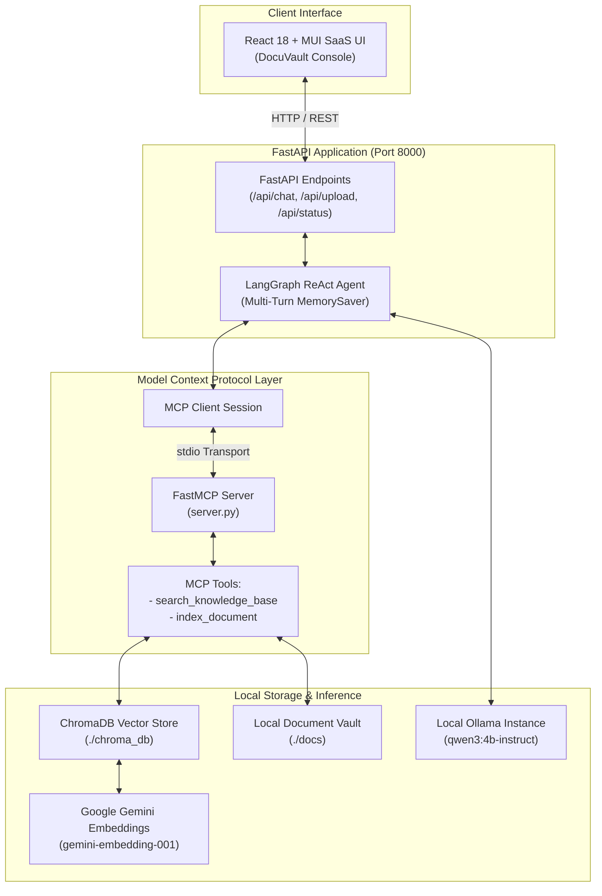

# DocuVault - Enterprise Knowledge OS

> Local-first Retrieval-Augmented Generation (RAG) and Model Context Protocol (MCP) engine powered by LangGraph, ChromaDB, and local Ollama inference with a modern React + Material-UI SaaS frontend.

---

## Overview

**DocuVault** is an enterprise-grade private document retrieval and conversational intelligence platform. It runs language model inference locally on your machine via Ollama, integrates with ChromaDB for 3072-dimensional vector search, and exposes its knowledge retrieval capabilities via the **Model Context Protocol (MCP)**.

The frontend is a modern React application styled in a clean bright slate (`#f8fafc`) and emerald green (`#10b981`) aesthetic, featuring real-time document vault inspection, vector metrics, collapsible context chunk viewers, and drag-and-drop document ingestion.

---

## Architecture



---

## Key Features

- **Local-First Privacy**: Language model inference runs entirely on your local machine via Ollama (`qwen3:4b-instruct`). Your prompts and document contents never leave your device for completion generation.
- **Model Context Protocol (MCP)**: Native FastMCP stdio server and client integration providing autonomous dynamic tool routing (`search_knowledge_base`, `index_document`).
- **Autonomous LangGraph Agent**: ReAct execution loop equipped with conversational checkpointer memory (`MemorySaver`) for multi-turn contextual dialog.
- **Dense Vector Search**: Powered by ChromaDB using Google Gemini `models/gemini-embedding-001` (3072 dimensions) for high-precision semantic retrieval.
- **Universal Document Ingestion**: Upload `.pdf`, `.txt`, and `.md` files via top navigation, composer paperclip, or full-workspace drag-and-drop. Automatic chunking and vector persistence.
- **Fail-Safe Grounding**: Built-in retrieval safety net ensures factual questions are grounded in verified document chunks even across long multi-turn sessions.
- **Modern SaaS Frontend**: Clean bright white and emerald green UI with persistent document inventory, real latency counters (ms), and exact context chunk inspection.

---

## Project Structure

```text
mcp-rag-engine/
├── .env.example             # Example environment configuration template
├── .gitignore                # Root git ignore rules for Python, Node, and vector data
├── LICENSE                   # MIT open-source license
├── README.md                 # Product documentation and setup guide
│
├── backend/                  # Python FastAPI, RAG, and MCP Server
│   ├── .env.example          # Backend environment template
│   ├── app.py                # FastAPI REST server & LangGraph agent
│   ├── rag_engine.py         # ChromaDB vector store & embeddings integration
│   ├── server.py             # Standalone FastMCP server (stdio transport)
│   ├── agent.py              # Standalone CLI autonomous ReAct agent
│   ├── requirements.txt      # Python dependencies
│   └── docs/                 # Document vault for knowledge base files
│       ├── policy.txt        # ACME Corp Employee Handbook
│       ├── products.txt      # ACME Titan Server specifications & pricing
│       └── security_policy.txt # Security guidelines and access policies
│
└── frontend/                 # React 18 + Material-UI SaaS application
    ├── index.html            # Application entry HTML with custom SVG favicon
    ├── package.json          # Frontend dependencies and build scripts
    ├── vite.config.js        # Vite configuration with /api reverse proxy
    ├── public/
    │   └── favicon.svg       # Custom geometric emerald vault favicon
    ├── dist/                 # Pre-compiled static assets served by FastAPI
    └── src/
        ├── main.jsx          # React DOM entry point
        ├── App.jsx           # Root layout with persistent sidebar and routing
        ├── theme.js          # Emerald & bright slate MUI theme
        ├── index.css         # Global typography and scrollbar styles
        ├── components/
        │   └── Sidebar.jsx   # Persistent 260px SaaS navigation panel
        └── pages/
            ├── Console.jsx   # Full-width chat workspace & ingestion interface
            ├── Privacy.jsx   # Dedicated data governance and privacy policy
            └── Terms.jsx     # Dedicated terms and operational agreement
```

---

## Prerequisites

1. **Python 3.10+**
2. **Node.js 18+** (Optional, only required if modifying the frontend)
3. **Ollama**: Installed and running locally ([Download Ollama](https://ollama.com/))
4. **Google Gemini API Key**: For 3072-dimensional vector embeddings ([Get API Key](https://aistudio.google.com/app/apikey))

---

## Quickstart Guide

### 1. Clone the Repository

```bash
git clone https://github.com/your-username/mcp-rag-engine.git
cd mcp-rag-engine
```

### 2. Set Up the Backend

```bash
cd backend

# Create virtual environment
python -m venv .venv

# Activate virtual environment
# Windows (PowerShell):
.\.venv\Scripts\Activate.ps1
# macOS / Linux:
source .venv/bin/activate

# Install dependencies
pip install -r requirements.txt
```

### 3. Configure Environment Variables

```bash
cp .env.example .env
```

Edit `.env`:
```ini
GEMINI_API_KEY=your_actual_gemini_api_key_here
GOOGLE_API_KEY=your_actual_gemini_api_key_here
```

### 4. Pull the Local LLM via Ollama

Ensure Ollama is running, then pull the target model:

```bash
ollama pull qwen3:4b-instruct
```

### 5. Start the Application

From within the `backend/` directory:

```bash
python -m uvicorn app:app --host 127.0.0.1 --port 8000 --reload
```

*(Or from the repository root: `python -m uvicorn backend.app:app --host 127.0.0.1 --port 8000 --reload`)*

Open your browser and navigate to:
**`http://127.0.0.1:8000/`**

---

### 6. (Optional) Frontend Development

Pre-compiled production assets are already included in `frontend/dist`. If you want to modify or rebuild the frontend:

```bash
cd frontend
npm install
npm run build
```

Open your browser and navigate to:
**`http://127.0.0.1:8000/`**

---

## API Reference

| Method | Endpoint | Description |
|---|---|---|
| `GET` | `/api/status` | Returns operational metrics, active vector count, and indexed documents. |
| `POST` | `/api/chat` | Processes user query with conversational memory and returns tool execution traces. |
| `POST` | `/api/upload` | Multipart form endpoint to upload and automatically index `.pdf`, `.txt`, or `.md` files. |
| `POST` | `/api/ingest` | Ingests a local file by providing its relative path (`{"file_path": "docs/file.txt"}`). |
| `GET` | `/{full_path:path}` | Serves the single-page React frontend and static assets. |

---

## MCP Tools Reference

The application exposes two Model Context Protocol tools:

1. **`search_knowledge_base(query: str) -> str`**
   - Retrieves the top-$k$ most semantically relevant chunks from ChromaDB for the given query.
   - Formats and returns grounded text chunks separated by markdown dividers.

2. **`index_document(file_path: str) -> str`**
   - Reads a local text, markdown, or PDF document via `TextLoader` or `PyPDFLoader`.
   - Splits content into 300-character chunks with 50-character overlap using `RecursiveCharacterTextSplitter`.
   - Embeds and persists chunks into ChromaDB.

---

## Security & Privacy Guarantees

- **No Remote Prompt Logging**: User prompts are processed locally through Ollama.
- **Encrypted Embeddings**: Embeddings are generated via TLS 1.3 to Google Generative AI endpoints solely for calculating vector representations. Data sent to these developer endpoints is not used to train foundation models.
- **Isolated Vector Storage**: All index data is stored in the local SQLite-backed `./chroma_db` directory.
- **Zero Third-Party Trackers**: No analytics scripts, cookies, or telemetry beacons are included.

---

## License

This project is licensed under the MIT License. See [LICENSE](LICENSE) for details.

